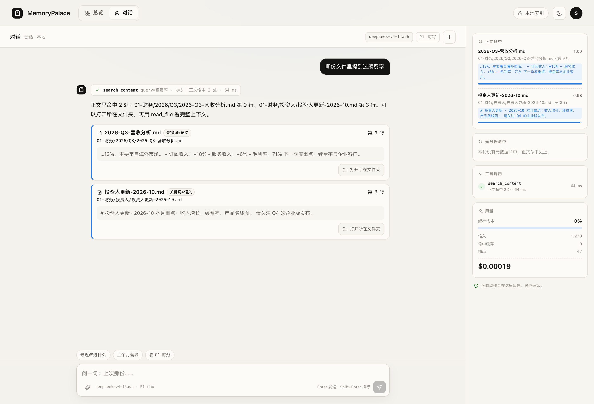

# MemoryPalace · 本地文件记忆助手

把电脑里散落的文件夹变成一张可对话的地图：问一句「上次那份讲营收的 PDF 在哪」，助手负责索引、检索、定位。文件不复制、不上传，整个应用只跑在本机回环地址上。




## 它能做什么

- **索引一个文件夹**：文件名、相对路径、类型、大小、修改时间；文本、PDF、DOCX 另外抽取正文块。
- **正文检索**：SQLite FTS5 trigram 关键词检索 + 本地 `bge-base-zh-v1.5` 向量，RRF 融合；关键词命中时抑制纯语义结果，避免「看起来像」的噪声。
- **对话式检索**：流式回答 + 工具调用（搜文件、搜正文、读元数据、读文本、列目录、Finder 定位）。命中卡片可以直接打开所在文件夹。
- **确认式写入**：新建 / 覆盖先给 diff 预览，移动、删除都要在确认卡上点允许；删除只会 `rename` 进系统废纸篓，代码里没有 `rm`。
- **显式长期记忆**：只有用户说「记住……」并经确认后才写入，跨会话注入；相似内容合并，会话开始时定格快照。
- **可观测**：每次模型调用的 token / 缓存 / 成本、工具调用 trace、允许与拦截的审计日志。
- **安全边界**：敏感文件（`.env`、私钥、凭据等）永不读取；文件内容一律按不可信数据处理；路径必须落在工作区内；HTTP 只绑定 `127.0.0.1`。

## 快速体验（不需要 API key）

需要 **Node.js 24+**。准备两个终端。

终端 1，启动后端：

```bash
cd server
npm install
MP_PROVIDER=mock MP_EMBED=0 npm start
```

终端 2，启动前端：

```bash
cd demo
npm install
VITE_MP_LIVE=1 MP_BACKEND_URL=http://127.0.0.1:4310 npm run dev
```

打开 <http://localhost:5173>。

`MP_PROVIDER=mock` 使用的是规则替身模型，但索引、检索、工具循环、SSE、确认卡、落库都是真实链路。示例数据在 `workspace-sample/`：23 个文件、9 个主题，其中 `workspace-sample/私有/` 放了 3 个用来演示拦截的假敏感文件。

只想看界面、不启动后端：

```bash
cd demo && npm install && npm run dev
```

这是纯前端脚本演示，数据来自 `demo/src/data.ts`。

> `MP_EMBED=0` 表示只走关键词检索，启动时不下载模型。想体验语义混合检索就去掉这个变量；首次运行会下载约 103 MB 的 `bge-base-zh-v1.5`（ONNX q8）。

## 接真实模型

1. 复制配置模板：

   ```bash
   cp server/.env.example server/.env
   ```

2. 在 `server/.env` 里填 API key（默认供应商是 DeepSeek，模型 `deepseek-v4-flash`）：

   ```dotenv
   MP_PROVIDER=deepseek
   DEEPSEEK_API_KEY=sk-你的key
   ```

3. 指定要索引的工作区，必须是绝对路径：

   ```dotenv
   MP_WORKSPACE=/Users/you/Documents/你的文件夹
   ```

   不填时只索引仓库里的 `workspace-sample/`，**不会自动扫描桌面**。

4. 启动后端和前端：

   ```bash
   cd server && npm start        # 默认 http://127.0.0.1:4310
   ```

   ```bash
   cd demo && VITE_MP_LIVE=1 MP_BACKEND_URL=http://127.0.0.1:4310 npm run dev
   ```

`server/.env` 已在 `.gitignore` 里。API key 只由后端读取，不会下发到浏览器。端口、写操作开关、废纸篓目录、向量检索、确认超时等配置项见 [`server/.env.example`](server/.env.example)。

## 仓库结构

```
server/            Node 24 + TypeScript（原生 TS 运行，无构建）
  src/index/       扫描、切块、建索引
  src/rag/         正文抽取、关键词 / 向量 / 混合检索
  src/runtime/     agent loop、工具、上下文装配、确认流
  src/model/       DeepSeek 适配器 + mock 模型
  src/policy/      路径、敏感文件、脱敏、注入扫描、废纸篓
  src/store/       SQLite（node:sqlite）表与迁移
  test/            node:test，128 个用例
demo/              React 19 + Vite 前端（总览 / 对话）
workspace-sample/  可直接安全扫描的示例工作区
docs/              设计与 harness 文档
```

## 开发命令

```bash
cd server
npm run typecheck            # 类型检查
npm test                     # 128 个用例（强制 MP_EMBED=0，不下载模型）
npm run eval:rag             # 正文检索 eval：关键词 / 向量 / 混合对比
npm run eval:rag:paraphrase  # 改写问法集，观察语义检索补盲区
```

## 设计文档

- [后端设计](docs/backend/DESIGN.md) · [正文与混合检索](docs/backend/RAG.md) · [MVP 收敛与验收](docs/backend/CONVERGENCE.md)
- [Harness 各模块笔记](docs/harness/README.md)：上下文装配、记忆、技能、运行时、工具层、模型适配、策略护栏、会话状态、可观测与评估
- [后端说明](server/README.md) · [前端说明](demo/README.md)

## License

[MIT](LICENSE)
